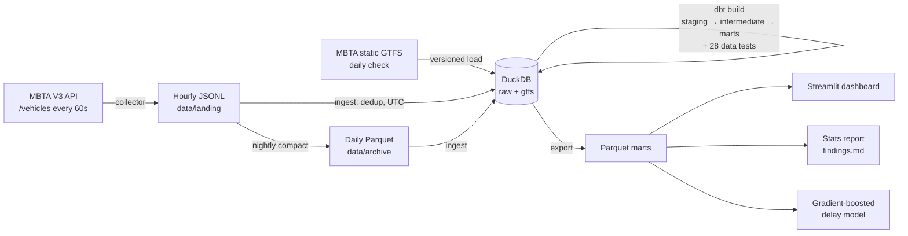

# MBTA Bus Reliability Pipeline

An end-to-end data pipeline that records the live position of every MBTA bus once a minute, reconstructs when each bus actually reached each stop, compares that with the published schedule, and answers:

- **Which routes are least reliable, and when?**
- **How much does the posted schedule understate real travel time?**
- **Do weekends differ from weekdays?**
- **Can we predict how late a bus will be at the next timepoint?**



| Layer | Tech | Where |
|---|---|---|
| Extract | Python + `requests`, `If-Modified-Since`, backoff and 429 handling | [transit/collector.py](transit/collector.py) |
| Load | DuckDB, incremental and idempotent, dedup on `(vehicle_id, updated_at)` | [transit/ingest.py](transit/ingest.py), [transit/gtfs.py](transit/gtfs.py) |
| Transform | dbt (dbt-duckdb): window functions, range joins, time-zone macros | [dbt/models](dbt/models) |
| Schedule | launchd (macOS), cron + systemd (Linux), or GitHub Actions | [deploy/](deploy), [.github/workflows](.github/workflows) |
| Analysis | SciPy: Mann-Whitney U, Wilcoxon, bootstrap CIs, Benjamini-Hochberg | [analysis/stats.py](analysis/stats.py) |
| Model | scikit-learn `HistGradientBoostingRegressor`, time-based split, baselines | [analysis/model.py](analysis/model.py) |
| Dashboard | Streamlit + Altair | [dashboard/app.py](dashboard/app.py) |

## Quick start

```bash
make setup                      # venv + dependencies (Python 3.10+)
export MBTA_API_KEY=...         # optional, free: https://api-v3.mbta.com/register
.venv/bin/python -m transit gtfs      # load the static schedule
.venv/bin/python -m transit collect   # leave running; Ctrl-C to stop
# in another terminal, whenever you like:
make refresh                    # ingest + dbt build + export marts
make analyze                    # writes data/marts/findings.md
make train                      # after a few days of data
make dashboard
make test                       # end-to-end test on synthetic data
```

## Collecting for several weeks

The analysis needs weeks of data, and a laptop that sleeps will leave gaps. Choose one of these:

1. **Mac, always plugged in:** run `make install-launchd`. This installs the collector (restarted automatically if it dies), a refresh every 15 minutes, and a nightly GTFS check plus compaction. Run `caffeinate -s` to keep the Mac awake.
2. **Any Linux box or small VM:** use [deploy/transit-collector.service](deploy/transit-collector.service) and [deploy/crontab.example](deploy/crontab.example).
3. **GitHub Actions (free, no hardware):** push the repo to GitHub and add `MBTA_API_KEY` as a repository secret. [collect.yml](.github/workflows/collect.yml) collects in back-to-back runs of about 5h50m each and uploads Parquet artifacts. Run `scripts/pull_github_data.sh && make refresh` locally to pull them in. Two caveats: GitHub can delay scheduled runs by a few minutes, and artifacts expire after 90 days.

The collector uses one API request per minute for all buses, which is well under the 20 requests/minute limit that applies without a key.

## How arrival times are inferred

The API gives a position about every 60 seconds, not stop arrivals, and a bus can pass three stops between pings. The core model ([int_ping_progress](dbt/models/intermediate/int_ping_progress.sql) → [int_stop_events](dbt/models/intermediate/int_stop_events.sql)) turns positions into arrivals:

1. **Progress scale.** Each ping gets a continuous position along its trip, where stop *k* is `k`. `STOPPED_AT k` maps to `k`. `IN_TRANSIT_TO k` maps to `k − (distance to stop k ÷ length of segment k−1→k)`, using haversine distance from GPS.
2. **Monotonic filter.** GPS jitter can make a bus appear to move backwards. Those pings are flagged and left out of interpolation.
3. **Interpolation.** Consecutive pings `(p0, t0) → (p1, t1)` bracket every stop `p0 < k ≤ p1`. Each of those stops gets an arrival time `t0 + (k − p0)/(p1 − p0)·(t1 − t0)`. The first stop gets the last ping still at the origin, which is its departure time. Gaps longer than 10 minutes are not interpolated. `interp_window_sec` is kept on each event as an error bar.
4. **Trip instances and service dates.** Pings are grouped by `(trip, vehicle)` using a 90-minute gap rule. The service date is `date(local ping time − scheduled seconds + 12h)`. This correctly places a trip scheduled at `25:10:00` on the previous day, with no calendar lookup.
5. **Schedule times.** GTFS times are relative to *noon minus 12 hours*, not midnight, and the two differ by an hour on DST changeover days. The [gtfs_to_utc](dbt/macros/time.sql) macro handles this, and the test suite checks it on 2026-03-08.

Data-quality handling includes:

- Duplicate polls are removed at ingest.
- Stale reports older than 10 minutes when polled are dropped.
- Non-revenue buses and shuttles with no GTFS match are excluded.
- Every GTFS feed version is kept, so trips from an older schedule still match.
- A matched delay larger than 3 hours is treated as a bad match and dropped.
- dbt tests check key uniqueness, referential integrity, accepted values, and that arrival times increase along each trip.

**Metrics:**

- **On time** follows the MBTA bus standard: between 1 minute early and 6 minutes late at a timepoint.
- **Bunching** means an observed headway under 50% of the scheduled headway; **gapping** means over 150%.
- **Runtime excess** is observed minus scheduled end-to-end running time.

**Statistics:** stop events on the same trip are correlated, so the hypothesis tests use one value per trip, not per stop. Treating each stop as independent would make almost any difference look significant.

## Results

> Fill this in after collecting. `make analyze` writes every number below to `data/marts/findings.md`.

- Route **X** runs more than 6 minutes late **Y%** of the time during the weekday 3–7pm peak.
- End to end, buses take a median **+Z min** longer than scheduled. On route **R**, actual running time is **N×** the posted time.
- Weekday vs. weekend: …
- The delay model predicts the delay at the next timepoint with an MAE of **M min**, against **P min** for the naive "stays as late as it is now" baseline.

## Resume bullets (replace the placeholders with your numbers)

- Built an automated Python ETL pipeline ingesting real-time MBTA GTFS vehicle positions every 60s into DuckDB, processing **{raw_pings}** pings over **{weeks}** weeks with de-duplication, stale-record filtering, time-zone/DST-correct schedule matching, and versioned GTFS loads.
- Modeled the data in dbt (window functions, range joins, 28+ data tests) to infer **{stop_events}** stop arrivals via GPS-based interpolation and compute schedule adherence, headways, and bunching across **{routes}** routes; found route **X** runs 6+ min late **Y%** of the time in the evening peak.
- Built a Streamlit dashboard of on-time performance by route and hour, and trained a gradient-boosted model predicting next-timepoint delay within **{mae}** min MAE (**{improvement}%** better than a persistence baseline).

`{raw_pings}`, `{weeks}`, `{stop_events}`, and `{routes}` come from the "Pipeline numbers" section of `findings.md`. `{mae}` and `{improvement}` come from `data/marts/model_metrics.json`.

## Ideas for extending it

- **Validate the interpolation** against the MBTA's published [bus arrival/departure times](https://mbta-massdot.opendata.arcgis.com/) for the same dates, and report the error.
- Add weather data (for example from Open-Meteo) as a model feature and test whether rain changes delays.
- Move storage to PostgreSQL. The dbt models are standard SQL apart from a few DuckDB functions (`epoch_us`, `make_timestamp`, `min_by`).
- Wrap `refresh` in an Airflow or Dagster DAG if you want that on the resume.
